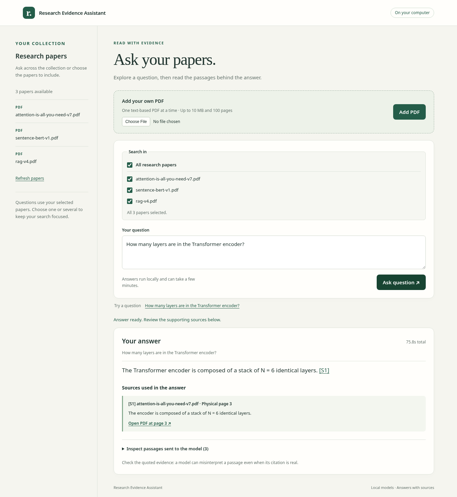
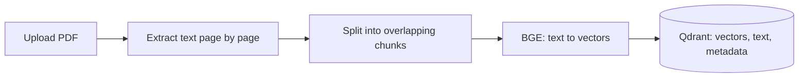
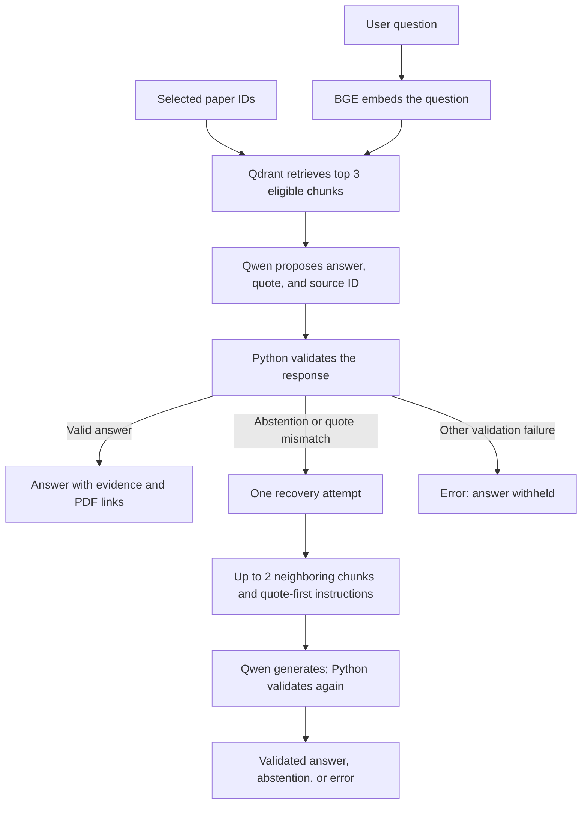

# Research Evidence Assistant

Ask questions about your research papers, read answers with source quotes, and open the cited PDF pages to check the evidence. A local **Retrieval-Augmented Generation (RAG)** application built with BGE embeddings, Qdrant, Qwen, and Flask.

[Setup](docs/setup.md) · [How RAG works](#understand-the-rag-pipeline) · [Using the app](#using-the-app) · [Evaluation](#evaluation-what-was-actually-measured) · [API guide](docs/backend-api.md)

**Status: working portfolio prototype.** Upload, search, answer generation, deletion, and PDF citation links work locally. Answer reliability remains limited; this project demonstrates the pipeline and its failure modes.



*Interface preview using a recorded local-model answer. The screenshot replays that result; it is not a new live accuracy measurement.*

## What you can do

- Upload a research PDF and ask questions about one paper, several selected papers, or the whole collection.
- Read answers alongside evidence quotes, filenames, and physical page numbers.
- Click a citation to open the original PDF at its cited page.
- Inspect the passages sent to the model, including any neighboring context.
- Delete web-uploaded papers from both app storage and the search index.
- See the difference between insufficient evidence, an invalid quote, and a service error.

Inference runs locally after setup. No paid model API is required. Uploading a PDF does **not** train or fine-tune either model.

## Why this project?

Research papers often spread useful details across sections and pages. This app helps you find those passages and ask focused questions such as “How many encoder layers are used?” or “What warmup schedule does the paper report?” You can then inspect the quote in its original PDF instead of relying on the generated explanation alone.

The project demonstrates a complete local RAG workflow: preparing documents, retrieving relevant passages, generating answers, checking source quotes, and measuring where the system succeeds or fails. It is a reading aid and a learning project; answer quality still needs human review.

## Using the app

1. **Choose your sources.** Use the included reference collection after setup, or add a text-based PDF with **Add PDF**. Upload one file at a time.
2. **Select papers.** Under **Search in**, tick one or several papers, or choose **All research papers**. A new upload is selected automatically; tick other papers to include them too.
3. **Ask a focused question.** The app searches only your selected papers. Answers run locally and can take a few minutes.
4. **Check the evidence.** Read the quoted passage and click `[S1]` or **Open PDF at page…** to view the original source. Expand **Inspect passages sent to the model** to see the model's context.
5. **Manage your collection.** Use **Delete** beside a web upload to remove its stored copy and indexed passages. The original file you uploaded from is unaffected; imported reference papers are protected.

You must select at least one paper to ask a question. Custom selections survive **Refresh papers**. Selecting several papers makes them eligible for retrieval, but does not guarantee that every selected paper appears in the answer.

## Understand the RAG pipeline

RAG gives a pretrained model relevant source material when answering a question. In this project, document preparation and question answering are separate operations.

### 1. Prepare the documents



1. **Extract:** pypdf reads text while preserving physical PDF page numbers.
2. **Chunk:** split text into manageable passages, using up to 320 content tokens with 40-token overlap. A chunk never crosses a physical page boundary.
3. **Embed:** BGE converts each chunk into a 384-dimensional vector. Related text can have similar vector directions.
4. **Store:** Qdrant keeps the vector together with the original text, filename, page, character offsets, and document/chunk IDs. This avoids embedding the whole collection for every question.

The PDF's SHA-256 identifies its exact bytes. Uploading identical bytes reuses the indexed document; different files can safely share a filename.

### 2. Answer a question



- **Retrieve:** embed the question with BGE and rank eligible chunks by cosine similarity. Paper checkboxes filter the search to the selected document IDs before ranking. The default three matches are shared across that selection; selecting more papers does not guarantee a passage from each.
- **Generate:** send the question and labeled passages (`S1`, `S2`, etc.) to Qwen. Qwen proposes an explanation, a supporting quote, and the passage ID.
- **Validate:** Python checks output structure, source IDs, quote provenance, and written numerals against the quoted evidence. Filenames and pages come from stored metadata, not invented model references.
- **Recover once:** if the first attempt refuses or its quote does not match, retry with optional neighboring text and instructions to select evidence before writing the answer. Every recovered answer must pass the same checks. No third attempt is made.

The embedding model actually computes the vectors; Qdrant stores and searches them. Qwen receives retrieved text and generates the answer. Python checks the proposed sources and quotes before the app displays an accepted answer. These are separate responsibilities, and no step updates either model's weights.

**Neighboring chunks** are the immediate passages before or after retrieved chunks in the same document. They may contain a sentence's continuation on the next page. They are not simply the fourth- and fifth-ranked search results. At most two are added, each with its own page identity; optional context is removed first if it exceeds the generator's context budget.

### Answer, quote, and citation are different

| Item | Example |
|---|---|
| Question | How many layers are in the Transformer encoder? |
| Generated answer | The encoder has six layers. |
| Evidence quote | “The encoder is composed of a stack of N = 6 identical layers.” |
| Citation | `[S1]` → original PDF, physical page 3 |

The quote must occur in the cited passage, allowing limited PDF typography normalization. A sentence fragment can be a valid quote. Combining words from separate passages and assigning them to one source is invalid.

**A real quote does not prove that the explanation is correct, relevant, or complete.** The current validator cannot reliably verify meaning. Similarly, a high similarity score is not answer confidence, and an abstention does not prove that the whole document lacks an answer.

## Technology

| Component | Implementation |
|---|---|
| PDF extraction | pypdf; original pages and character offsets |
| Embedding model | BAAI/bge-small-en-v1.5, pinned revision, 384 dimensions |
| Vector search | Qdrant local mode; cosine similarity |
| Generator | Qwen3.5-2B Q4_K_M through pinned llama.cpp |
| Generation settings | CPU, 4,096-token context, 384-token output cap |
| Backend | Flask |
| Frontend | HTML, CSS, JavaScript; no frontend build required |
| Experimental retrieval | BM25 and reciprocal-rank fusion via CLI |

BGE and Qwen are both pretrained. BGE finds relevant text; Qwen writes the answer. Neither model's weights change during indexing or question answering.

## Run locally

Supported setup: **Linux x86-64, Python 3.12, CPU inference**. No GPU or API key is required. Internet access is needed for initial downloads; inference runs locally afterward.

For a first installation, follow the [complete setup guide](docs/setup.md), which covers:

1. Creating the Python environment and installing dependencies.
2. Caching the pinned BGE embedding model.
3. Downloading and verifying Qwen and the llama.cpp runtime.
4. Downloading the three reference papers and building the local search index.

The startup commands below assume those steps are complete.

Then, from the repository root, keep these running in separate terminals:

```bash
# Terminal 1: local answer model
.venv/bin/python -m scripts.start_local_model
```

```bash
# Terminal 2: web application
HF_HUB_OFFLINE=1 .venv/bin/python -m api.app
```

Open [http://127.0.0.1:8000/](http://127.0.0.1:8000/) and try:

> How many layers are in the Transformer encoder?

The website runs on port **8000** and the local model server on **8081**. Keep both terminals running. Models and indexed papers persist between sessions, so daily use requires only these two startup commands.

Use the [demo walkthrough](docs/demo.md) for a short presentation. Restart the app after Python code changes and refresh the browser; automatic reload is disabled. The model server can stay running.

## Evaluation: what was actually measured

The [evaluation summary](reports/final-evaluation.md) separates software tests, retrieval measurements, and reviewed answer quality.

| Check | Recorded result | Interpretation |
|---|---|---|
| Automated software tests | 87 passed | Tested software behavior, including multi-paper selection, not LLM accuracy |
| Historical complete designated evidence at top 3 | Dense 5/10; BM25 7/10; fusion 5/10 | Retrieval coverage on ten answerable reference questions |
| Final five-question development check | Two supported factual answers, two abstentions, one incompletely supported answer | Small inspected development sample, not a held-out benchmark |

The reference corpus contains three pinned papers, 45 pages, and 158 chunks: **Attention Is All You Need**, **Sentence-BERT**, and **Retrieval-Augmented Generation for Knowledge-Intensive NLP Tasks**. Their versions, checksums, questions, and evidence locations are in the [reference manifest](data/evaluation/research-papers.json).

The current 87-test suite includes six tests added for multi-paper selection. The evaluation report preserves the earlier 81-test baseline and its separate live-model observations.

There is no single final full-corpus answer-accuracy score. For example, recovery answered “What does attention mean?”, but its quote still did not support every detail of the explanation. Intermediate failures and the final recovery-only design are documented in the [continuation report](reports/continuation-context.md).

## Limitations

- Answers may omit requested details, refuse answerable questions, or extend beyond their quotes.
- Tables, formulas, comparisons, and evidence spanning pages remain difficult.
- Each statement currently cites one passage; multi-source evidence per statement is not implemented.
- Uploads are limited to **10 MiB and 100 pages**; scanned/image-only and encrypted PDFs are unsupported.
- The local app serves one expensive operation at a time and has no multi-user authentication or production deployment setup.
- PDF page links are available; exact evidence highlighting and OCR are not implemented.

## Repository guide

```text
api/               Flask endpoints, HTML templates, CSS, JavaScript
scripts/           Extraction, chunking, indexing, retrieval, generation, evaluation
config/            Pinned generator model/runtime configuration
data/evaluation/   Versioned paper manifest and reference questions
data/samples/      Small synthetic teaching fixtures
tests/             Automated software checks
docs/              Setup, demo, component guides, and learning history
reports/           Evaluation results and documented failure analysis
```

Models, downloaded papers, uploaded files, indexes, environments, and full runtime traces are excluded from Git. They are created locally during setup/use.

## Documentation

- [Setup, daily use, and troubleshooting](docs/setup.md)
- [Short demo and portfolio description](docs/demo.md)
- [Evaluation summary](reports/final-evaluation.md)
- [API endpoints and error behavior](docs/backend-api.md)
- [PDF upload and deletion](docs/pdf-upload.md)
- [Web interface and citation links](docs/web-interface.md)
- [Evaluation reproduction](docs/research-evaluation.md)
- [Learning log](docs/learning-log.md) and [earlier development walkthrough](docs/development-history.md)

## Run the tests

After installing dependencies and caching BGE as described in setup:

```bash
HF_HUB_OFFLINE=1 .venv/bin/python -m unittest discover -s tests -v
.venv/bin/python -m pip check
```

These checks use temporary data, cached tokenization, and controlled model responses. The generator does not need to be running. Live-model evaluation is a separate step documented above.
